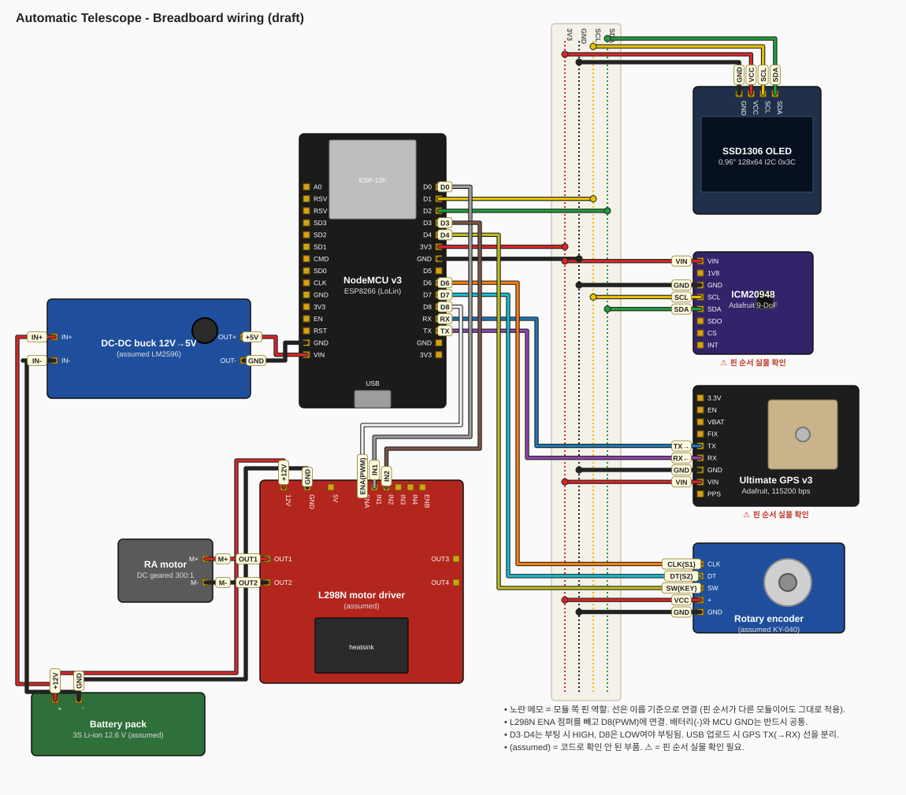
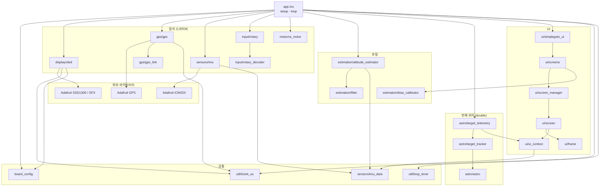
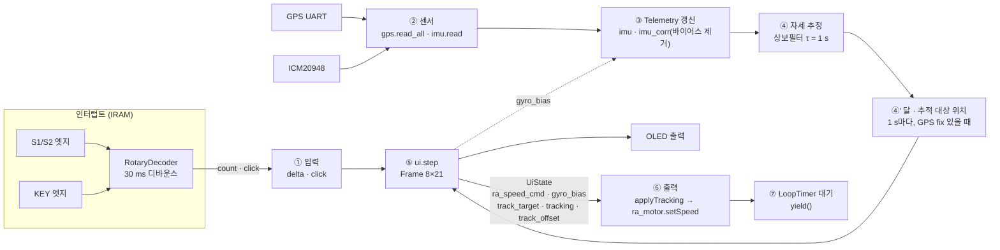
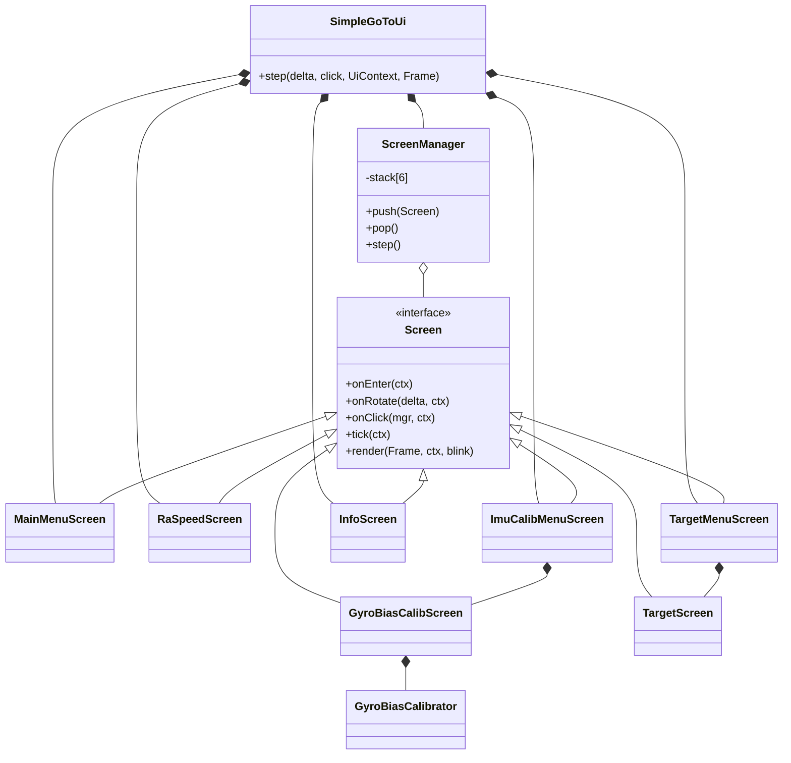

# 자동 망원경 아키텍처 (초안)

이 문서는 현재 코드(`refactor/structure` 브랜치) 기준으로 그린 초안입니다. 핀 정보의 원본은 [board_config.h](../../Arduino/app/src/board_config.h)이고, 전원·전장은 WireViz([wiring.yml](wiring.yml)), 소프트웨어는 Mermaid로 그립니다.

`(가정)`(배선도에서는 `(assumed)`)이 붙은 부분은 코드에 나타나지 않아 추정으로 채운 것입니다. 실제 장비와 대조해서 고쳐 주세요.

---

## 1. 전원·전장 아키텍처

### 1.0 브레드보드 배선도 (실물 배치)



Fritzing 브레드보드 뷰처럼 그린 그림입니다. 모듈은 실제 크기(6 px ≈ 1 mm)와 실제 핀 순서로, 선은 직선·직각으로 그립니다. 모듈 쪽 선 위의 노란 메모는 그 핀의 역할(GND, VCC, TX, RX 등)입니다.

- 원본은 [breadboard/breadboard.yml](breadboard/breadboard.yml)이고, `python docs/architecture/breadboard/render.py`로 SVG를 다시 만듭니다.
- 3V3, GND, I2C(SCL/SDA)는 브레드보드 레일 하나에 모아서 한 핀에 선이 두 개 꽂히지 않게 했습니다.
- `⚠` 표시 모듈(ICM20948, Ultimate GPS)은 핀 순서를 실물로 확인하지 못했습니다. 메모의 핀 이름을 기준으로 연결하면 순서가 달라도 맞습니다.

### 1.0.1 하네스 목록 (WireViz)

같은 연결을 케이블 단위로 정리한 그림입니다: [wiring.svg](wiring.svg) (원본 [wiring.yml](wiring.yml)).

- 배터리 12 V는 강압 컨버터(→ NodeMCU VIN 5 V)와 모터 드라이버 VM으로 나뉩니다. 센서와 표시장치는 NodeMCU의 3V3 출력을 씁니다.
- GND는 배터리, 강압 컨버터, MCU, 모터 드라이버가 모두 공통으로 연결되어야 합니다.
- I2C 버스는 OLED(0x3C)와 ICM20948이 함께 씁니다.
- 상태바의 전압 `V 12.60`은 아직 측정하지 않는 고정값입니다. 실측하려면 분압 저항을 A0에 연결해야 합니다(미구현).

### 1.1 핀 표

| NodeMCU | GPIO | 연결 | 비고 |
|---|---|---|---|
| D0 | 16 | 모터 IN1 | 인터럽트 불가 핀 |
| D1 | 5 | I2C SCL (OLED, IMU) | |
| D2 | 4 | I2C SDA (OLED, IMU) | |
| D3 | 0 | 모터 IN2 | 부팅 시 HIGH 필요 |
| D4 | 2 | 로터리 KEY | 부팅 시 HIGH 필요, 온보드 LED |
| D6 | 12 | 로터리 S1 (CLK) | |
| D7 | 13 | 로터리 S2 (DT) | |
| D8 | 15 | 모터 PWM (EN) | 부팅 시 LOW 필요 |
| RX / TX | 3 / 1 | GPS TX / RX | UART0, USB와 공유 |

**주의할 점**
- D3, D4, D8은 부팅 모드를 정하는 핀입니다. 모터 드라이버나 엔코더 모듈이 부팅 순간 이 핀을 반대 레벨로 끌면 부팅하지 않습니다.
- GPS가 UART0을 쓰므로 USB로 펌웨어를 올릴 때 GPS TX 선을 빼야 할 수 있습니다.
- 처음 구상에 있던 LED와 MPU9250은 현재 코드에서 쓰지 않아 그림에서 뺐습니다.

---

## 2. 소프트웨어 아키텍처

### 2.1 모듈 구성

화살표는 include 방향(사용하는 쪽 → 쓰이는 쪽)입니다.



- UI, 추정, 천체 위치 모듈은 하드웨어 라이브러리를 쓰지 않습니다. 그래서 PC에서 단위시험(`Arduino/test`)과 GUI 시뮬레이터(`Arduino/tools/ui_simulator`)로 그대로 빌드할 수 있습니다.
- `rotary_decoder`와 `ra_motor`는 순수 로직(`onEdge`, `toOutput`)을 분리해 두어 PC에서 시험합니다.

### 2.2 메인 루프 데이터 흐름 (10 Hz)



- UI는 `UiContext` 하나로만 펌웨어와 주고받습니다. `Telemetry`는 메인 루프가 채워서 UI가 읽고, `UiState`는 UI가 바꿔서 메인 루프가 읽습니다.
- Gyro Bias Calib 화면이 만든 `gyro_bias`는 다음 프레임부터 `imu_corr`에 반영됩니다(점선).

### 2.3 UI 구조



`InfoScreen`을 상속하는 화면: GpsStatus, AccGyro, MagTemp, ImuCalibStatus, AttEst, Health, MoonAxis, Sleep. 화면별 내용은 [UI.md](../UI.md)에 있습니다.

---

## 3. 렌더링 방법

- **Mermaid (소프트웨어):** GitHub, VS Code의 Markdown 미리보기(확장 설치 시)에서 바로 그림으로 보입니다.
- **WireViz (전원·전장):** Graphviz와 WireViz를 설치한 뒤 다음 명령으로 `wiring.svg`/`wiring.png`/`wiring.html`을 만듭니다. `wiring.yml`을 고치면 다시 실행해서 그림도 함께 커밋해 주세요.

```powershell
winget install --id Graphviz.Graphviz
```

```powershell
pip install wireviz
```

```powershell
$env:PYTHONUTF8 = '1'; wireviz docs/architecture/wiring.yml
```

- 한국어 Windows에서는 `PYTHONUTF8=1` 없이 실행하면 WireViz가 SVG를 cp949로 읽다가 실패합니다.
- 배선도 라벨은 영어로 씁니다. Graphviz 기본 글꼴에 한글이 없고, 라벨 안의 `->`는 WireViz가 이스케이프하지 않아 오류가 납니다(`→` 사용).

---

## 4. 펌웨어 빌드

CPU 클럭은 **160 MHz**로 씁니다. 천체 위치 계산이 `double`(소프트웨어 부동소수점)이라 80 MHz보다 약 두 배 빨라지고, ESP8266은 160 MHz를 공식 지원합니다(전류가 수 mA 늘어나는 정도).

- `Arduino/scripts/build.sh`는 FQBN `esp8266:esp8266:nodemcuv2:xtal=160`으로 빌드합니다. 80 MHz로 빌드하려면 `FQBN=esp8266:esp8266:nodemcuv2`를 지정합니다.
- Arduino IDE에서는 **Tools → CPU Frequency → 160 MHz**를 고릅니다. 80 MHz로 빌드하면 컴파일 경고가 나오고, 부팅 화면 첫 줄 `1. Display ON 160MHz`의 숫자로도 확인할 수 있습니다.

```powershell
bash Arduino/scripts/build.sh
```
